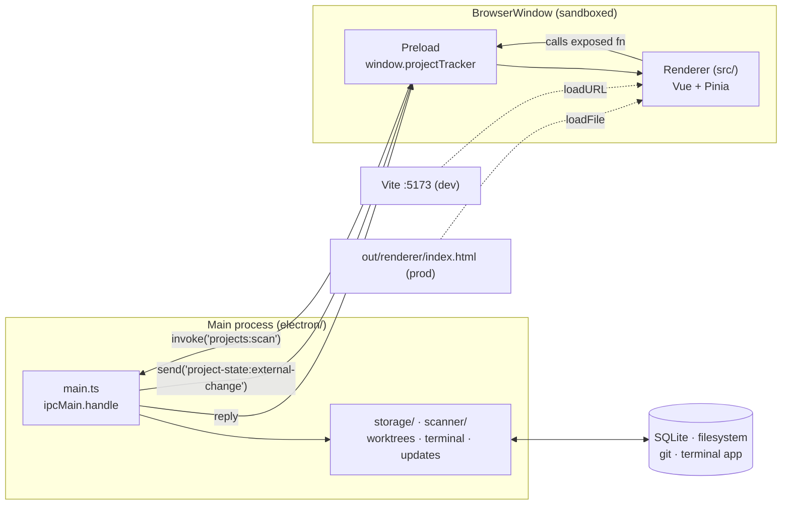

# Project Tracker (Electron)

Project Tracker is a macOS desktop app for keeping track of projects on your machine. Point it at the folders where you keep your work, then use the dashboard to check priorities and status or open a project's ticket board. Your data stays in a local SQLite database.

## Features

- See each project's status, priority, notes, README and GitHub stats on the dashboard.
- Give each project its own ticket board. Add as many swim lanes as you need and drag tickets between them.
- Save an agent prompt for each lane, including the built-in No status column. You can also point it at a markdown file for extra instructions.
- Import open GitHub issues as tickets. Importing again skips issues you've already pulled in, using the issue number to avoid duplicates.
- Assign shared tickets to a user and use the *Assigned to me* filter to find your work.

Open a ticket and press **▶ Run** to run its agent (Claude Code by default; Codex, Hermes or your own CLI per ticket) in the background. The agent gets the lane's prompt, its markdown file and the ticket's fields. Its output is saved on the ticket and survives a restart. A run can be cancelled while it works, and a failed run says why.

## Prerequisites

- macOS for packaged builds; development may work on other platforms
- Node.js 18+ (22+ recommended)
- Bun or npm to install dependencies

## Setup

Clone the repository, then open the app directory and install dependencies:

```bash
cd electron-app
bun install
```

If you use npm:

```bash
npm install
```

## Development

Start the Vite dev server and Electron together with hot reload:

```bash
bun run dev
```

Vite runs on `http://127.0.0.1:5173`, and Electron opens once the server is ready. You don't need to set any environment variables.

## Production build

Build the renderer and Electron main process:

```bash
bun run build
```

To debug the build locally, run it with Electron:

```bash
bun run build
bun run start:dev
```

Create a macOS `.dmg` and `.zip`:

```bash
bun run dist
```

You'll find the files in `dist/`. To open the packaged `.app`:

```bash
bun run start:prod
```

## Releasing

The packaged app updates itself from
[GitHub Releases](https://github.com/notTag/ProjectTrackerElectronApp/releases)
using `electron-updater`. On launch it checks for a newer release, downloads it
in the background, and installs it when you quit. The check is skipped in
development, and a failed check (offline, no release yet, bad signature) is
logged and ignored, so it never blocks the app from starting.

To publish an update for people who already have the app installed:

1. Bump `version` in `package.json`. The updater only installs a higher version.
2. Build, sign, notarize and upload:

   ```bash
   GH_TOKEN=<token with repo scope> \
   APPLE_ID=<apple id email> \
   APPLE_APP_SPECIFIC_PASSWORD=<app-specific password> \
   APPLE_TEAM_ID=<team id> \
   bun run release
   ```

3. Open the draft release on GitHub and publish it. The updater ignores drafts.

`bun run release` uploads the `.dmg`, `.zip`, and `latest-mac.yml` update
manifest. The `.zip` is what the updater downloads, so keep both targets.
`bun run dist` builds the same files without publishing them, so those builds
won't reach the updater.

macOS refuses an update it can't verify, so every release must be:

- **Signed** with the same Developer ID Application certificate as the installed
  app. electron-builder picks it up from your keychain automatically.
- **Notarized.** electron-builder notarizes when the `APPLE_*` variables above
  are set. On its own it would only log `skipped macOS notarization` and carry
  on, so `bun run release` checks first and stops before building if there is no
  GitHub token (`GH_TOKEN`, `GITHUB_TOKEN` or `GITHUB_RELEASE_TOKEN`) or the
  notarization variables are missing or incomplete. It doesn't check the signing
  certificate, so make sure it's in your keychain first. An App Store Connect
  API key (`APPLE_API_KEY`, `APPLE_API_KEY_ID`, `APPLE_API_ISSUER`) or a
  `notarytool` keychain profile (`APPLE_KEYCHAIN_PROFILE`) works instead of an
  Apple ID.

## Other scripts

| Command | Description |
|---------|-------------|
| `bun run typecheck` | Run TypeScript checks for Vue and Electron code |
| `bun run test` | Run Vitest unit tests |
| `bun run start:dev` | Run the built app with Electron's development host |
| `bun run start:prod` | Open the packaged `Project Tracker.app` from `dist/` |
| `bun run release` | Build and upload a GitHub release for automatic updates |

## Project structure

```
electron-app/
├── electron/
│   ├── main.ts        # Window lifecycle, IPC handlers, GitHub API
│   ├── preload.cts    # contextBridge (compiled to CommonJS)
│   ├── scanner/       # Filesystem project discovery
│   └── storage/       # SQLite schema and repository
├── src/
│   ├── views/         # DashboardView, BoardView
│   ├── stores/        # Pinia stores
│   ├── shared/        # Types and pure reducers — compiled into both processes
│   └── services/      # IPC client wrapper
├── assets/            # App icon and static assets
├── build/             # electron-builder resources (entitlements)
├── out/               # Compiled app, generated by `bun run build`
│   ├── renderer/      # Vite bundle of src/
│   └── main/          # tsc output of electron/ and src/shared/
└── dist/              # Packaged .app, .dmg, .zip, generated by `bun run dist`
```

## Architecture

The app is written in TypeScript. Electron's main process handles database access, files and GitHub requests, so there's no separate backend server to run.

| Process | Runtime | Responsibilities |
|---------|---------|------------------|
| **Main** (`electron/`) | Node.js, ES2022/NodeNext ESM | SQLite, filesystem scanning, GitHub API, window lifecycle, IPC handlers |
| **Preload** (`electron/preload.cts`) | sandboxed bridge | Exposes the renderer's API through `contextBridge`. Compiled to CommonJS (`.cts`) because sandboxed preloads cannot load ESM |
| **Renderer** (`src/`) | Chromium, sandboxed | Vue 3 UI. No filesystem or database access; everything goes through `window.projectTracker` IPC |



Both processes compile `src/shared/`, so the Vue components and SQLite layer use the same type definitions, including `Ticket`. This directory also holds the pure reducers for lane deletion, ticket numbering and GitHub import. The unit tests cover these reducers.

The main process opens the database file directly with `node:sqlite`, which is built into Electron's Node, so there's no native module to rebuild. The database runs in WAL mode with a 5 second busy timeout. A second app instance or the `sqlite3` CLI can read and write while the app is open. Each write is its own transaction, committed by SQLite.

## Data storage

The app saves its data outside the repository, in Electron's `userData` directory:

```
~/Library/Application Support/Project Tracker/project-tracker.sqlite
```

When you write file contents into a text column from the `sqlite3` CLI, wrap them as `CAST(readfile('<path>') AS TEXT)`. A bare `readfile()` returns a BLOB, which SQLite stores as-is. The app decodes BLOBs as UTF-8 when it reads them, but other tools may not.

Projects, swim lanes and tickets are stored as shared rows, so every member sees the same edits. Project membership determines who can see a project; ticket assignment records who's working on it.

| Table | Notes |
|-------|-------|
| `users` | currently one local user, with room for more in the schema |
| `projects` | keyed by absolute path |
| `project_members` | who can see a project; scanning a project adds membership |
| `swim_lanes` | ordered by `position`; `is_unassigned` flags the undeletable No status column |
| `tickets` | `assignee_id` is nullable and `ON DELETE SET NULL`, so removing a user releases their tickets rather than deleting the work |
| `project_paths` | hidden / third-party classification, shared like the project |
| `user_paths` | scan directories specific to each machine, never shared |
| `user_settings` | individual settings for each user |
| `schema_meta` | schema version, for future migrations |

There are two exceptions to the normalized schema, documented in `electron/storage/schema.ts`:

- `tickets.lane_id` isn't a foreign key. Tickets can sit in the virtual unassigned column, which only gets a `swim_lanes` row when you configure its prompt.
- Labels, checklists and agent runs are stored in JSON columns rather than separate tables.

### Known limits

- Every save still sends the entire state over IPC. The main process compares it with the state it last handed out and writes only what changed: changed fields for tickets, changed rows for everything else. The renderer doesn't call the row-level repository methods yet.
- Changes another process makes reach the app within about 10 seconds, when the window regains focus, or when you focus a field in a ticket. The background check skips while a field has focus, so it never replaces text you're typing.
- When two writers edit the same ticket field, or the same lane, project or setting, the last write wins.
- `node:sqlite` is still experimental in Node 22 and logs an `ExperimentalWarning` at startup.

## Tech stack

- [Electron](https://www.electronjs.org/) — desktop shell
- [Vue 3](https://vuejs.org/) + [Pinia](https://pinia.vuejs.org/) + [vue-router](https://router.vuejs.org/) — UI, state and routing
- [Vite](https://vitejs.dev/) — dev server and bundler
- [node:sqlite](https://nodejs.org/api/sqlite.html) — SQLite built into Node, used from the main process
- [electron-builder](https://www.electron.build/) — macOS packaging

## Troubleshooting

**Dev server won't start**

Check that nothing else is using port `5173`. The dev script runs Vite at `127.0.0.1:5173`.

**`bun run start:dev` shows a blank window**

Run `bun run build` first. The `start:dev` script expects built output in `out/`.

**Dock or menu bar still says Electron**

Use `bun run dist` followed by `bun run start:prod`. `start:dev` runs Electron's stock development host, which macOS labels as Electron.

**Database from an older version**

Databases written by older versions (sql.js) open in place. The first launch on the new engine copies the file to `project-tracker.pre-wal-backup.sqlite` in the same folder before switching it to WAL mode.
